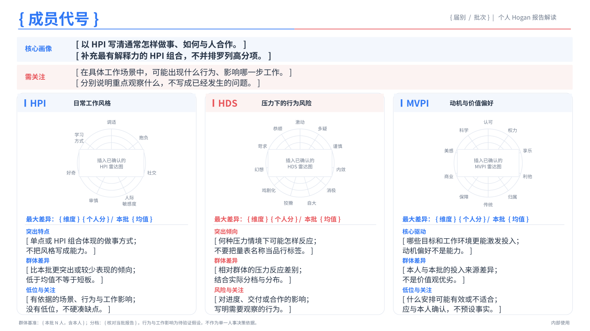
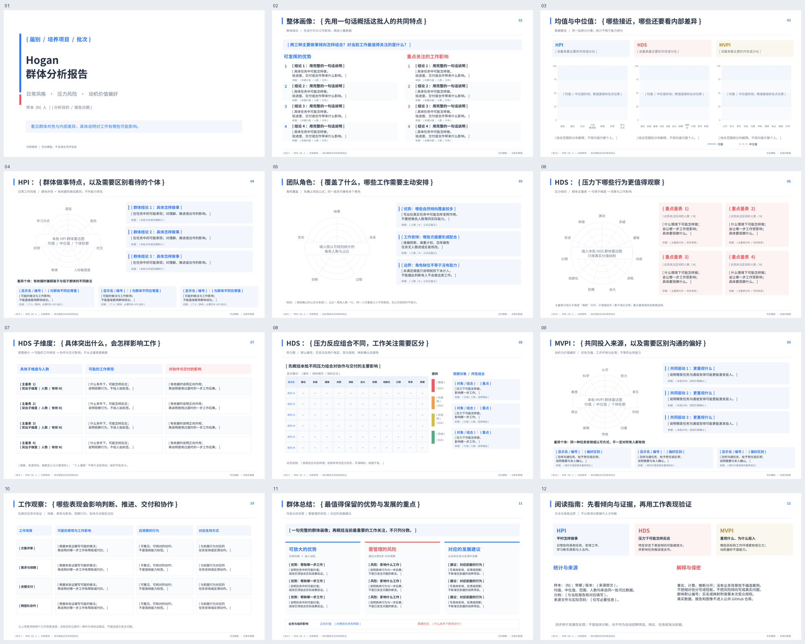
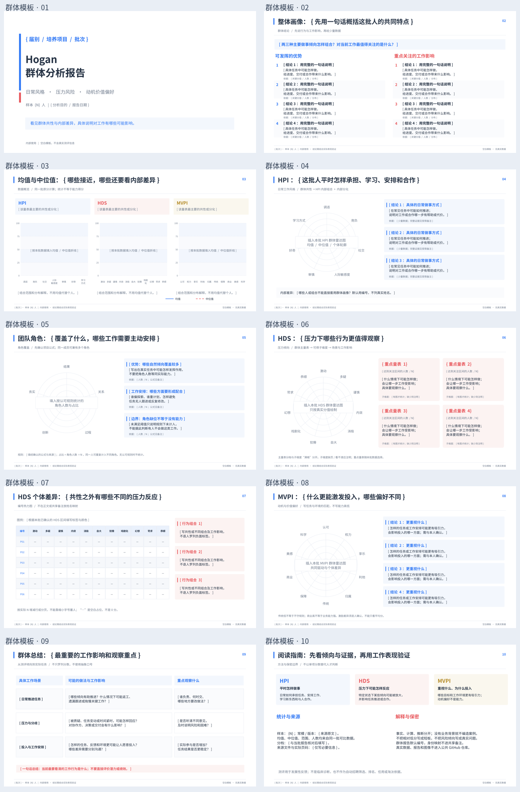

# Hogan群体与个人报告 Skill · v1.0

**把获授权的测评报告，变成能核对的数据图和能读懂工作影响的PPT。**

流程：输入检查与保密 → 分值交叉核验 → 本批统计 → 雷达图确认 → HPI主导的个人画像 / 群体分析 → 模板PPT → 渲染与交付。

整合群体报告分支要求：专业但直白的管理解读、群体与差异个体同页、点位标数、授权实名展示和三栏总结。这里只发布方法与模板，不发布受测者资料。

## 适用范围

支持个人报告、群体报告、两者分别交付，以及明确请求时的跨批对比。个人核心画像主要基于HPI单点和HPI内部组合，HDS说明特定压力倾向，MVPI说明投入偏好；三者不相加成能力分。不用于自动招聘筛选、人才排名、任用或临床诊断。

这是供有文件读取、计算、绘图与PPT制作能力的AI使用的**工作流型Skill**，不是上传ZIP即全自动完成的独立软件。现有脚本不会抽取所有PDF，也不会自动写出心理解释或填完PPT。

## 可以直接用的PPT模板

| 模板 | 实际文件 | 预览与结构 |
|---|---|---|
| 个人报告 · 1页 | [individual-report-template.pptx](assets/templates/individual-report-template.pptx) | 顶部核心画像/需关注；下方HPI、HDS、MVPI三栏，保持既有雷达图区域 |
| 完整群体管理解读 · 12页 | [group-management-template.pptx](assets/templates/group-management-template.pptx) | HPI共性与差异同页、HDS子维度单页、热力图、工作观察、三栏总结 |
| 群体报告 · 10页（兼容） | [group-report-template.pptx](assets/templates/group-report-template.pptx) | 整体画像、统计、HPI、角色、HDS、热力图、MVPI、工作影响与指南 |

### 个人模板



### 新增：12页管理解读模板



### 兼容：10页群体模板目录预览



模板从空白PPT重新建立：可编辑文字、图形和空白图表区域，不携带真实姓名、分数、旧雷达图、原备注、公司标志或外部链接。正式运行时用核对后的数据/图像填入；不是给历史报告简单改名。内部品牌模板可由用户单独指定，在私有运行目录使用，不加入本仓库。

坐标、对象名称和逐页字段见[`template-map.json`](assets/templates/template-map.json)与[`management-template-map.json`](assets/templates/management-template-map.json)，使用规则见[`template-layout.md`](references/template-layout.md)。

## 第一次使用，提供这些材料

完整报告优先：每人HPI、HDS、MVPI完整PDF，通常3N份；摘要推荐加上，用于交叉核验。另说明批次/届别、期望人数、展示代号、均值基准、输出范围及获准阅读的对象。岗位类型、工作阶段、典型任务和合作对象各一句话，有助于把影响写准。

只给分数可做数据核对和统计，但不能声称读过完整详报；只有HPI就只分析HPI；只有汇总均值不反推个体、中位值或角色分布。HDS子维度必须有可读原图及定义。

完整清单：[input-requirements.md](references/input-requirements.md)。可填写任务单：[request-form.md](assets/input/request-form.md)。

**不要在公开仓库、Issue或Pull Request里填写真实输入。** 原报告、缩写、分数、群体结论及备注仍可能包含受保护信息；先确认处理权限与组织允许的环境。

## 如何让AI使用

在支持该格式及所需工具的宿主中加载完整目录，或在允许文件式调用的环境里提供这个包，让执行者先读`SKILL.md`。上传文件不等于已安装Skill，安装/启用方式以宿主环境为准。[S1]

示例调用（只填获授权的信息）：

> 使用Hogan群体与个人报告Skill，先阅读SKILL.md。附件是获授权的新一批报告；批次【填写】，人数【填写】，使用随机代号，以本批N人均值为基准、包含本人。输出个人和群体PPT，采用内置模板。先交付雷达图，等我确认后继续。个人核心画像主要基于HPI；写清具体工作行为、可能影响和关注点。

确认后：

> 当前雷达图没问题，继续完成PPT。

不要在用户确认后只回复“正在处理”。执行者应在当前执行回合完成可完成的报告、检查和交付；真实工具故障应明确说明。

## 话术约定

**管理解读：结论先行 → 具体工作表现与影响 → 少量数据支撑。**

通俗但适合正式汇报，不只是改成聊天口吻；优势要说明工作价值，风险要说明合理后果，建议要对应行为。个人以HPI组合体现立体做事方式，群体兼顾共性与差异个体。总结用“可放大的优势／需管理的风险／对应的发展建议”，再说明正向价值与需要防范。

个人：HPI单点/组合 → 做事方式 → 具体场景 → 可能影响 → 观察重点。
群体：共性与分化 → 工作里的可能做法 → 进度/交付/协作影响 → 分别关注什么。

不写“把想法接上闭环”，而写“提出方案后，明确谁负责、何时交，并持续跟进到完成”。不写“提升灵活性”，而写“需求改变后，能否调整优先级和交付范围，避免继续做不再需要的内容”。这些是写法示例，正式结论仍需当前报告证据。

完整规范：[writing-style.md](references/writing-style.md)。

## 目录

```text
hogan-personal-report/
  SKILL.md                     # AI执行说明，含模式与确认流程
  README.md                    # GitHub介绍与使用方法
  CHANGELOG.md                 # v1.0 / v2.0 / v2.1改动
  NOTICE.md                    # 用途/版权/许可边界
  requirements-templates.txt    # 仅重建模板所需依赖
  TESTING.md                   # 已测范围与未覆盖的环节
  .gitignore                   # 避免误收运行数据，不是保密保证
  references/
    confidentiality.md         # 授权、信息分级、GitHub边界
    input-requirements.md       # 输入层级与缺失处理
    writing-style.md            # 管理解读、立体画像与工作影响
    branch-integration.md       # 分支依据、边界与工程化补充
    report-options.md           # 12/10页、姓名权限、热力图标签
    analysis-rules.md           # 解释边界与证据矩阵
    group-analysis.md           # 群体/角色/子维度/跨批比较
    data-contract.md            # 标准化JSON和算术规则
    template-layout.md          # 两套实际模板的使用方法
    review-gate.md              # 用户确认及版本冻结
    quality-checklist.md        # 每一步验收项
    provenance.md               # 来源与方法边界
  assets/
    templates/                 # 1页个人、12页管理解读、10页兼容群体PPT及字段映射
    previews/                  # 经目检的空白模板预览
    input/                     # 任务单和明确标注的虚构样例
    release-allowlist.json      # 已审核二进制版本哈希
  scripts/
    validate_scores.py         # 28维输入/来源/均值/差值校验
    group_stats.py             # 中位值/范围/分档人数/可选项目角色
    review_gate.py             # v1个人图确认与哈希校验
    inspect_pptx.py             # 页数、对象、坐标、越界检查
    style_check.py              # 部分空泛/随意措辞提示
    narrative_check.py          # 解读卡的结构缺项检查
    plan_report.py              # 统计量、结构、实名授权字段检查
    build_management_template.py # 新建12页管理解读空白模板
    release_check.py            # 有限发布扫描，不是DLP工具
    build_templates.py         # 重建空白模板，不生成正式分析
  tests/                       # 全部为合成测试
```

## 本地核验命令

原三个核验脚本和新统计/检查脚本仅需Python 3.10+标准库。仅在需要**重建模板**时，另需`python-pptx`，可按组织许可执行`python -m pip install -r requirements-templates.txt`；本包已提供可直接使用的PPT，不必为查看模板安装它。

```bash
# 在技能根目录运行；测试数据均为虚构
python -m unittest discover -s tests -v
python scripts/release_check.py .
```

实际运行需使用仓库外的获授权目录；`RUN`由用户或执行环境设置，不将真实路径提交仓库：

```bash
python scripts/validate_scores.py "$RUN/scores.json" --out "$RUN/score_audit.json"
python scripts/group_stats.py "$RUN/scores.json" --out "$RUN/group_stats.json"
python scripts/inspect_pptx.py assets/templates/group-report-template.pptx --out "$RUN/template_inventory.json"
python scripts/style_check.py "$RUN/analysis_draft.md" --out "$RUN/writing_audit.json"
```

需要按区间统计人数时，将示例规则复制至运行目录，先核对适用区间与来源，确认后再执行：

```bash
python scripts/group_stats.py "$RUN/scores.json" --display-rules "$RUN/display_rules.json" --out "$RUN/group_stats.json"
```

`display-rules.example.json`默认`confirmed=false`，不能原样当作真实口径。项目角色只能在用户认可规则时通过`--include-project-roles --role-rule-source '实际认可来源说明'`启用；不作为官方效度声明。

## 上传GitHub前

本次仅交付待上传的目录，未替用户建立仓库或推送。上传前先确认组织许可、仓库受众与可见性。代码、文档许可尚未替仓库所有者选定，见`NOTICE.md`。

运行测试和发布检查，人工逐页检查PPT及其备注、元数据，确认只包含空白模板与虚构样例。选择性暂存文件，不盲目`git add .`。例如在已准备好的本地仓库中：

```bash
git add SKILL.md README.md CHANGELOG.md NOTICE.md TESTING.md .gitignore .gitattributes
git add references scripts tests assets requirements-templates.txt
git diff --cached --stat
git diff --cached
```

这些命令不包含上传或推送。`.gitignore`不处理已经跟踪的文件，删除当前文件也不等于清掉Git历史；发现误传按组织事件流程处理。[G1][G2]

### GitHub仓库简介（可直接填写）

> Hogan群体与个人发展报告工作流：核验分数、确认雷达图、以HPI组合形成画像，并用管理解读说明工作价值、风险与支持重点。内置个人及10/12页群体PPT模板、输入清单、保密与展示权限检查，不携带真实数据。


## v2.1 新增怎么用

完整群体分析默认`group_profile=management12`；仍可选`compact10`或用户自定义。单批概览标均值/中位值，跨批默认仅均值。姓名显示默认编号；明确要求实名且受众有权查看、映射已确认时启用，不能把本次实名要求转成公开仓库内容。

```bash
python scripts/plan_report.py "$RUN/request.json" --out "$RUN/report_plan.json"
python scripts/narrative_check.py "$RUN/analysis_cards.json" --out "$RUN/narrative_audit.json"
python scripts/style_check.py "$RUN/analysis_draft.md" --out "$RUN/writing_audit.json"
```

先填解读卡，再写页面文本。示例见[analysis-card.example.json](assets/input/analysis-card.example.json)。上述检查只发现结构、选项和部分措辞问题，不能判定真正授权、心理解释或工作假设成立。真实运行记录不进仓库。

本次分支依据及覆盖限制见[branch-integration.md](references/branch-integration.md)；模板页码是该结构下的位置，不是所有报告硬性页码。

## 测试与限制

`TESTING.md`记录验证范围。有限检查通过不等于隐私风险为零、数据真实或结论有效；PDF阅读、语义解读、真实确认及PPT目检仍须执行者负责。不保证不同Office软件逐像素一致。

## 资料

[S1] Agent Skills specification，查阅2026-10-15：https://agentskills.io/specification

[G1] GitHub Docs，Ignoring files，查阅2026-10-15：https://docs.github.com/en/get-started/git-basics/ignoring-files

[G2] GitHub Docs，Removing sensitive data from a repository，查阅2026-10-15：https://docs.github.com/en/authentication/keeping-your-account-and-data-secure/removing-sensitive-data-from-a-repository
